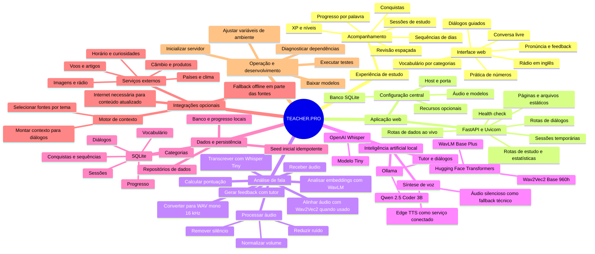

# TEACHER.PRO

**Tutor de inglês com prática de vocabulário, conversação e pronúncia.**


O TEACHER.PRO é uma aplicação web local para brasileiros estudarem inglês. Combina exercícios de vocabulário, diálogos, conversação livre e análise de pronúncia; o progresso é mantido em um banco SQLite no próprio ambiente em que o servidor está executando.

> **Privacidade e conectividade:** o backend, o banco e os modelos de linguagem e áudio são executados localmente depois de instalados. O projeto, porém, não é integralmente offline: a voz padrão usa Edge TTS, a rádio e os recursos de contexto podem acessar serviços externos, e o download inicial dos modelos requer internet. Evite enviar conteúdo sensível ao usar recursos conectados.

## Conteúdo

- [Recursos](#recursos)
- [Mapa mental](#mapa-mental)
- [Como funciona](#como-funciona)
- [Tecnologias e modelos](#tecnologias-e-modelos)
- [Requisitos](#requisitos)
- [Instalação e execução](#instalação-e-execução)
- [Configuração](#configuração)
- [Testes](#testes)
- [Estrutura do repositório](#estrutura-do-repositório)
- [Solução de problemas](#solução-de-problemas)
- [Licença e créditos](#licença-e-créditos)

## Recursos

| Área | O que oferece |
| --- | --- |
| Vocabulário | Categorias de estudo, exemplos, tradução, fonética e seleção de palavras para praticar ou revisar. |
| Pronúncia | Envio de áudio, transcrição, comparação com a frase esperada, pontuação e feedback. |
| Diálogos | Prática guiada por temas e geração de respostas com o modelo local via Ollama. |
| Conversa livre | Chat com contexto configurável e opção de enriquecimento com dados online. |
| Números | Uma área de prática dedicada na interface. |
| Progresso | Histórico de estudo, estatísticas, sequência de dias, XP, níveis e conquistas. |
| Rádio | Acesso a estações em inglês por meio de fontes externas. |
| Dados ao vivo | Rotas para clima, país, câmbio, produtos, voos, artigos, imagens, horário e curiosidades numéricas, com fallbacks para parte dos serviços. |

## Mapa mental

O diagrama resume os módulos que compõem a aplicação e como eles se relacionam. O modo online é complementar: chamadas externas são distintas da inferência local feita pelo Ollama e pelos modelos de áudio.



## Como funciona

### Análise de pronúncia

1. A interface envia a gravação ao endpoint local `/api/analyze`.
2. O servidor valida o arquivo, converte o áudio para WAV mono a 16 kHz e tenta remover silêncio, reduzir ruído e normalizar o volume.
3. Whisper Tiny produz a transcrição; o sistema compara o resultado com a frase esperada.
4. WavLM extrai representações acústicas usadas na análise e na pontuação.
5. O tutor consulta o Ollama para gerar feedback; se o serviço local não estiver disponível, há respostas alternativas implementadas.

### Estudo e persistência

Na inicialização, o servidor prepara o SQLite e executa a carga inicial de conteúdo. Os repositórios concentram as consultas e atualizações de categorias, vocabulário, progresso e sessões. A aplicação também registra dados de gamificação, como XP, níveis, sequências e conquistas.

### Conversação e dados online

Diálogos e conversa livre podem usar o Qwen servido pelo Ollama. Quando o uso de contexto ao vivo está ativo, o motor de contexto seleciona fontes externas conforme o tema. Essas chamadas dependem da internet; alguns serviços implementam dados de fallback para indisponibilidade.

## Tecnologias e modelos

| Componente | Tecnologia | Papel |
| --- | --- | --- |
| Servidor e API | FastAPI, Uvicorn | Aplicação HTTP local e endpoints. |
| Interface | HTML, CSS e JavaScript | Aplicação servida a partir de `src/web/static/`. |
| Persistência | SQLite | Conteúdo, progresso e sessões. |
| Processamento de áudio | librosa, noisereduce, pyloudnorm, FFmpeg | Conversão e preparação de gravações. |
| Transcrição | OpenAI Whisper Tiny | Reconhecimento de fala em inglês. |
| Análise acústica | Microsoft WavLM Base Plus | Extração de embeddings de áudio. |
| Alinhamento | Meta Wav2Vec2 Base 960h | Alinhamento forçado disponível no módulo de pronúncia. |
| Tutor e diálogos | Qwen 2.5 Coder 3B via Ollama | Geração local de respostas e feedback. |
| Voz | Edge TTS | Síntese de referência; requer conectividade para o serviço. |

Os modelos podem ser baixados sob demanda ou preparados com `download_models.py`. O download e os termos de uso dos modelos e serviços de terceiros são independentes da licença deste repositório.

## Requisitos

- Python 3.10 ou superior.
- FFmpeg disponível no `PATH` para conversão de formatos de áudio.
- Ollama instalado e em execução para respostas geradas pelo tutor; o modelo padrão é `qwen2.5-coder:3b`.
- Conexão com a internet para baixar dependências/modelos e para os recursos conectados, como Edge TTS e dados ao vivo.
- Memória e armazenamento suficientes para PyTorch e os modelos de áudio. O consumo varia conforme os modelos carregados; este repositório não define um requisito mínimo validado de hardware.

## Instalação e execução

Clone o repositório e crie um ambiente virtual:

```bash
git clone https://github.com/eartnet09-boop/TEACHER.PRO.git
cd TEACHER.PRO
python -m venv .venv
```

Ative o ambiente virtual:

```bash
# Linux/macOS
source .venv/bin/activate

# Windows PowerShell
.venv\Scripts\Activate.ps1
```

Instale as dependências do projeto e os pacotes usados pelo Whisper e pelo TTS, que não estão listados em `requirements.txt`:

```bash
python -m pip install --upgrade pip
pip install -r requirements.txt
pip install openai-whisper edge-tts
```

Instale e inicie o Ollama em outro terminal, depois baixe o modelo configurado:

```bash
ollama pull qwen2.5-coder:3b
ollama serve
```

Opcionalmente, baixe os modelos de áudio do Transformers para o cache local:

```bash
python download_models.py
```

Inicie o servidor:

```bash
python -m src.main
```

A interface ficará disponível em `http://127.0.0.1:8000`. Em ambiente de desenvolvimento, a documentação da API fica em `http://127.0.0.1:8000/docs`.

## Configuração

As principais opções são lidas de variáveis de ambiente por `src/config.py`. Não há arquivo `.env.example` no repositório; crie um `.env` manualmente apenas se precisar substituir os padrões.

| Variável | Padrão | Uso |
| --- | --- | --- |
| `HOST` | `127.0.0.1` | Endereço de escuta do servidor. |
| `PORT` | `8000` | Porta HTTP. |
| `ENVIRONMENT` | `development` | Controla, entre outros itens, a exposição de `/docs`. |
| `DB_PATH` | `english_teacher.db` | Caminho do arquivo SQLite relativo à raiz do projeto. |
| `OLLAMA_HOST` | `http://localhost:11434` | Endereço do Ollama configurado. |
| `LLM_MODEL` | `qwen2.5-coder:3b` | Modelo configurado para o tutor. |
| `DEVICE` | `cpu` | Dispositivo padrão para os modelos configuráveis. |
| `FEATURE_ONLINE_ENHANCE` | `false` | Flag de configuração para aprimoramentos online. |

Consulte `src/config.py` para as opções de áudio, pontuação, gamificação, segurança e demais variáveis. Algumas chamadas de serviços conectados também são controladas diretamente pela interface e pelos endpoints.

## Testes

Os testes de API usam um servidor já iniciado em `localhost:8000`. Em um terminal, execute `python -m src.main`; em outro, rode:

```bash
pytest tests/ -v
```

## Estrutura do repositório

```text
TEACHER.PRO/
├── download_models.py
├── requirements.txt
├── src/
│   ├── audio/                 # Processamento e gravação de áudio
│   ├── data/                  # SQLite, modelos, repositórios e seed inicial
│   ├── enhancements/          # Contexto e serviços online opcionais
│   ├── llm/                   # Tutor, prompts e motores de diálogo
│   ├── pronunciation/         # WavLM, pontuação e alinhamento
│   ├── transcription/         # Integração com Whisper
│   ├── tts/                   # Síntese de voz
│   ├── web/
│   │   ├── routers/           # Rotas adicionais da API
│   │   ├── static/            # Interface HTML
│   │   ├── app.py             # Aplicação FastAPI e endpoints
│   │   └── session_manager.py # Sessões temporárias
│   ├── config.py              # Configuração central
│   └── main.py                # Inicialização e diagnóstico
├── tests/                     # Testes de API, lógica e pontuação
├── LICENSE
└── README.md
```

## Solução de problemas

| Sintoma | Verificação |
| --- | --- |
| Ollama não responde | Confirme que `ollama serve` está ativo e que `qwen2.5-coder:3b` foi baixado. |
| FFmpeg não encontrado | Instale o FFmpeg para seu sistema operacional e confirme que o executável está no `PATH`. |
| Whisper não instalado | Ative o ambiente virtual e instale `openai-whisper`, além das dependências de `requirements.txt`. |
| Erro ao carregar modelo de áudio | Verifique a conexão no primeiro download, o espaço em disco e a compatibilidade das versões de PyTorch e Transformers. |
| Porta 8000 ocupada | Defina outra porta na variável `PORT`. |
| TTS ou contexto ao vivo indisponível | Esses recursos dependem de serviços externos; verifique a conexão. O TTS possui fallback silencioso, que não substitui uma voz offline. |

Para executar as verificações disponíveis na inicialização:

```bash
python -m src.main check
python -m src.main diagnose
```

## Licença e créditos

Este projeto é proprietário. Todos os direitos reservados a Expedito Anderson Rufino. Uso, cópia, modificação ou distribuição requerem autorização prévia e por escrito, conforme [LICENSE](LICENSE). Dependências, modelos, marcas e serviços de terceiros permanecem sujeitos aos próprios termos.

O projeto integra tecnologias e modelos de OpenAI (Whisper), Microsoft (WavLM), Meta (Wav2Vec2), Alibaba (Qwen), Ollama, FastAPI e demais dependências listadas em `requirements.txt`.
